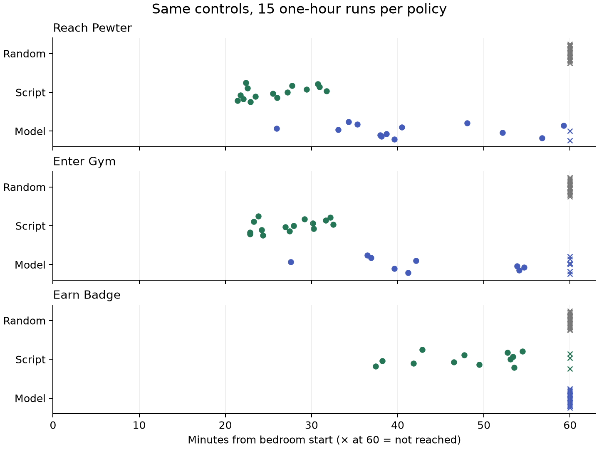
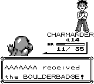
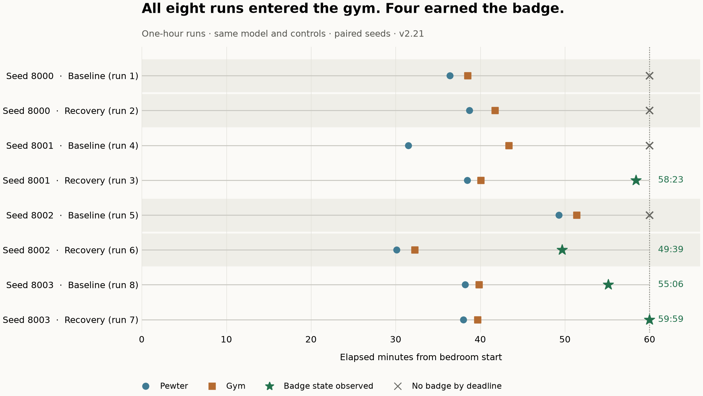

# Pokémon Red: The One-Hour Agent Lab — Logs and Results

An exploratory study of a local model playing Pokémon Red through an evolving assisted-play harness. The model chooses from offered actions; software supplies game state, explicit objectives, pathfinding and bounded dialogue/battle controls.

[Read the blog post](https://curtiscovington.com/posts/pokemon-red-one-hour-agent-lab/) · [Final results](results/final-batch-results.md) · [Model provenance](results/model-and-protocol.json) · [Evidence index](results/evidence-index.md)

## Follow-Up: Fixed Controls, Three Policies

The completed v2.25 comparison contains **45 additional one-hour runs**:15 random,15 route-and-combat script,15 pinned model. The script earned12 badges;model and random earned0. [Results and uniform audit](results/fixed-controls/README.md) · [Protocol](results/fixed-controls/protocol.md) · [Per-run archives](batches/v2.25/archive-index.json).

All three arms used the same corrected controls. The script adds explicit prior route/combat knowledge; this is a comparison under that harness. All45 completed outcomes are retained. The stopped development batch is excluded as a whole. Earlier model wins remain verified; the later decline remains unexplained. The follow-up article is currently a draft.



## First Post: What Happened

The final frozen comparison had eight one-hour runs, four per condition. All eight entered Pewter Gym. The setup that retained destinations through battles earned one badge; adding healing and restrictions on repeated journeys/conversations earned three. This is a small exploratory comparison of two assisted setups, not a general model-capability benchmark or an isolated estimate of any single repair's effect.



Original saved frame at 54:23 in baseline run 8. The frozen milestone metric first observed the badge state at 55:06, after dialogue. [Frame provenance](results/badge-award-provenance.json).



## Included Batches

Each completed batch has eight sequential one-hour runs. The collection covers about **40 hours 38 minutes of gameplay**, excluding loading/setup time and earlier experiments outside this timeline.

| Version | Batch ID | Runs | Purpose | Archive |
|---|---|---:|---|---|
| v2.14 | 20261011-212309-b75445 | 8 completed | Guidance and output format | [Logs](batches/v2.14/logs.tar.gz) |
| v2.15 | 20261012-082345-7459db | 8 completed | Goals before forest-boundary repair | [Logs](batches/v2.15/logs.tar.gz) |
| v2.16 | 20261012-170425-432bbf | 8 completed | Boundary repair | [Logs](batches/v2.16/logs.tar.gz) |
| v2.19 | 20261013-010754-95c758 | 8 completed | Recovery comparison, before audit repairs | [Logs](batches/v2.19/logs.tar.gz) |
| v2.20 | 20261013-100905-cacc2d | 1 interrupted | Separate doorway defect; excluded from final comparison | [Logs](batches/v2.20/logs.tar.gz) |
| v2.21 | 20261013-105028-575ffb | 8 completed | Frozen confirmation | [Logs](batches/v2.21/logs.tar.gz) |

Per-run summaries and metrics are also browsable under each batch's `runs/` directory. [Batch index](batch-index.json) records durations, seeds and archive hashes.

## Archive Contents And Scope

Each compressed archive contains the recorded `events.jsonl` decision/action log (including original requests, responses, embedded request images and timestamps), saved PNG frames, final observation/image, run manifests and metrics, batch manifest/report, and frozen Python source snapshot where available. Warmup entries are retained but have no scored elapsed time. Files inside archives are byte-for-byte copies of their local records; [member SHA-256 hashes](archive-members-sha256.json) allow verification.

The export uses a file allowlist and excludes ROMs, model weights, emulator save states, service/process/resource logs, controller state and streaming configuration. Historical local filesystem paths and loopback endpoints in manifests/source are retained as provenance; they are not portable installation instructions. Historical bugs in map labels or metrics remain in the original records. Reviewed interpretations and corrected labels are in `results/`.

This is an evidence archive, not a turnkey game distribution. It supports re-analysis of recorded decisions and outcomes. Starting-save hashes are recorded, but exact gameplay reruns require the original save and a legally obtained compatible ROM. Game images and text remain the property of their respective rights holders; their inclusion documents the experiment, and this repository grants no rights to those assets.

The selection includes every run from the six batches discussed in the post, including failures. It does not include all earlier development batches. The historical v2.19 audit was prompted by a disappointing result and covered selected cases; v2.21 received the same automated log checks for all eight runs. Neither was an exhaustive manual review of every frame.

## Verify And Recompute

Python 3 is sufficient to validate archives and reproduce the final log audit:

```sh
python3 scripts/verify-archives.py
mkdir -p extracted/v2.21
tar -xzf batches/v2.21/logs.tar.gz -C extracted/v2.21
python3 scripts/recompute-final-audit.py extracted/v2.21 --output audit-recomputed.json
python3 -c 'import json; assert json.load(open("audit-recomputed.json")) == json.load(open("results/final-batch-audit.json"))'
```

The audit checks badges and receipt dialogue, gym-guide selections, healing observations, navigation outcomes, recorded errors and frozen-source hashes. Scope limitations are embedded in its output. Optional figure regeneration requires Matplotlib:

```sh
python3 results/plot-final-milestones.py
```

Badge times use the first observed badge state. Runs without a badge are censored at 60 minutes, rather than omitted. Inference latency is separate from the time required to execute an action. Conditions share the same model, bedroom start, one-hour budget and paired seeds; the harness evolved between historical batches, so their outcomes are not interchangeable controlled comparisons.
